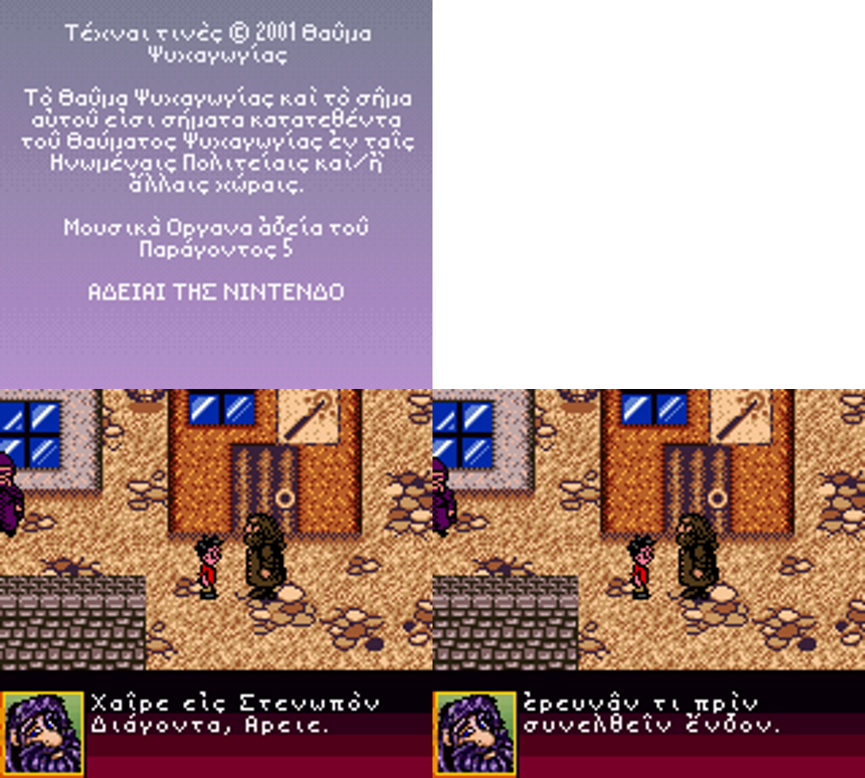

# Harry Potter and the Sorcerer's Stone (Game Boy Color) - Ancient Greek Translation
### Ἅρειος Ποτὴρ καὶ ἡ τοῦ φιλοσόφου λίθος (Ἑλληνικὴ Μετάφρασις)

A complete Ancient (Attic) Greek translation patch for *Harry Potter and the Sorcerer's Stone* on the Game Boy Color. It translates the whole script (**2,857 strings**: dialogue, menus, spells, items, credits and legal screens), replaces the font with a new 8x8 **polytonic Greek font** with proportional spacing, and ships the tools to rebuild the patch from the plain-text script.



---

## 🎮 How to Play

You need your own legally obtained copy of the ROM. **No game data is distributed in this repository** - only an IPS patch of changed bytes.

### Base ROM Specifications

| | |
| :--- | :--- |
| **Name** | Harry Potter and the Sorcerer's Stone (USA, Europe) (En,Fr,De,Es,It,Nl,Pt,Sv,No,Da,Fi).gbc |
| **Size** | 4,194,304 bytes (4 MiB) |
| **CRC32** | `4FD8B7C5` |
| **MD5** | `ba85a2ae8aa5829c440eef2d5549506c` |
| **SHA-1** | `4e6f676ec15e0e6238cb81853b5a74bbb20657a1` |

Patched ROM (for checking your result): CRC32 `DCA6FC36`, MD5 `08f0ed247c7471fae0263b355837aa49`, SHA-1 `f7eb8a7a5a72e3ee4f2ea736732383ff92f89aca`.

### Option 1: In the browser (easiest)
1. Open [RomPatcher.js](https://www.marcrobledo.com/RomPatcher.js/).
2. Choose your ROM, then choose [`patches/hp1_greek_us.ips`](patches/hp1_greek_us.ips) as the patch.
3. Click **Apply patch** and save the new `.gbc`.

### Option 2: Command line
```bash
python3 tools/apply_ips.py "Harry Potter and the Sorcerer's Stone (USA, Europe) (En,Fr,De,Es,It,Nl,Pt,Sv,No,Da,Fi).gbc" patches/hp1_greek_us.ips hp1_greek.gbc
```

### Playing
* At the language menu leave **English US** highlighted (it is the default) and press A. The patch replaces the English US text.
* Start a **new game with no old save file or save state** - saves made on the unpatched ROM carry the old text.
* The font is shared by all languages, so the other language options display scrambled text.

---

## ✨ Features
* **Complete script** - 3,063 strings, 2,857 translated. The remaining 206 are numbers, dates and placeholders and are left untouched.
* **Custom Greek font** - 24 capitals, 25 lowercase letters (with final sigma), ano teleia, and vowels with acute, grave, circumflex, smooth and rough breathings and diaeresis. See [`gfx/greek_font_sheet.png`](gfx/greek_font_sheet.png).
* **Proportional spacing** - the game's width tables are rewritten for every Greek glyph, so letters sit naturally instead of on a fixed grid.
* **Rebuildable** - edit the plain-text script, run one command, get a new patch.

## 🔤 Full Polytonic Orthography (Combining VWF Engine)
Like the SNES *Zelda: A Link to the Past* Ancient Greek project, this release features **complete, authentic polytonic Greek** with **zero dropped or merged forms**:

* **Additive Combining Diacritics (width = 0)**: Lowercase vowels support any combination of acute, grave, circumflex, smooth and rough breathings, diaeresis, and **iota subscript (ᾳ, ῃ, ῳ)**. Diacritics are blitted with additive `OR` without advancing the cursor.
* **Preceding Capital Diacritics (width = 2–3 px)**: Uppercase vowels carry authentic classical diacritics placed preceding the capital letter (e.g., `Ἅρειος`, `Ὦ`, `Ἐκεῖνος`).
* **Game Boy Z80 Engine Assembly Patches**: In Bank 1, the cursor advance check (`$65DA`) and word-wrap calculation (`$674D`, `$7066`) are hooked to detect zero-width combining marks and skip cursor advance.
* **Zero Merged Forms**: Every breathing, accent, circumflex, and iota subscript in the 2,857 translated strings is preserved 100%.

Full details and ROM technical map: [docs/translation_guide.md](docs/translation_guide.md).

## ✍️ Modifying & Rebuilding the Translation
1. Edit [`text/greek_script.tsv`](text/greek_script.tsv) (`index<TAB>x<TAB>greek`). Allowed characters: [docs/allowed_characters.txt](docs/allowed_characters.txt).
2. Check it against the font and engine rules:
   ```bash
   python3 tools/validate_script.py rom.gbc text/greek_script.tsv
   ```
3. Build the patch:
   ```bash
   python3 tools/build_patch.py rom.gbc text/greek_script.tsv build/hp1_greek.gbc patches/hp1_greek_us.ips full us
   ```
   The build also writes `build/hp1_greek.gbc.report.txt` (size used, merged forms, words too wide for the text box).
4. To see the English for any row, dump it from your own ROM: `python3 tools/dump_script.py rom.gbc english_script.tsv us`.

## 🛠️ Technical Details & ROM Architecture
* **Text**: each language slot is a 3,063-entry pointer table plus Huffman-coded 7-bit symbols across six banks. The English US slot (banks `0x20`-`0x25`) is rewritten; the script uses 84,514 bytes.
* **Symbols**: 97 unused codes are assigned dynamically to the Greek forms the script needs.
* **Font**: three copies of the 8x8 1-bit font and three width tables are updated. Glyph for code *c* is at base + 8*c*; width = columns used; the engine advances width + 1 pixel.
* **Layout**: the engine word-wraps; lines up to 93 px are known to fit and 101 px overflows. `@1 @2 @3` are variables, `_` is a forced line break, `~` is the (c) sign.
* Full ROM map and glyph metrics: [docs/translation_guide.md](docs/translation_guide.md).

## 📁 Repository Structure
```text
.
├── README.md
├── LICENSE
├── patches/
│   └── hp1_greek_us.ips          # the patch (apply to the clean ROM)
├── text/
│   └── greek_script.tsv          # full Greek script, 3,063 rows
├── docs/
│   ├── translation_guide.md      # ROM map, reduced character set, limits
│   ├── translation_prompt.md     # prompt used for the Gemini translation
│   ├── harry_potter_glossary.md  # fixed Greek renderings of names and terms
│   └── allowed_characters.txt    # characters and tokens the script may use
├── gfx/
│   ├── screenshots.png
│   └── greek_font_sheet.png
└── tools/
    ├── build_patch.py            # script -> ROM / IPS
    ├── glyphs.py                 # mark composition
    ├── greek_art.py              # base letter bitmaps
    ├── validate_script.py        # rule checker
    ├── dump_script.py            # export the English text from your ROM
    └── apply_ips.py              # apply the patch without an external tool
```

## 🧭 Translation Methodology
The text was translated with Google Gemini from a fixed prompt (technical rules, glossary, style target) in batches of about 150 rows, then validated and merged by script. The register is Attic Greek in the manner of Andrew Wilson's *Ἅρειος Ποτὴρ καὶ ἡ τοῦ φιλοσόφου λίθος*. The prompt and glossary are in [`docs/`](docs/). The translation has not been through a full human editorial pass; corrections are welcome.

## 🐛 Known Issues
* **Playtesting is incomplete.** The patched ROM has been run through boot, the language menu, the copyright and legal screens, the file-select screen and the opening up to Ollivander's shop; the rest of the script has been verified by decoding it back out of the ROM, not by playing it.
* **Credits and legal screens** are rendered in Greek, including the company names (for example "Amaze Entertainment" appears as a Greek phrase), rather than being left in Latin letters.
* Row `2585` contains a 96 px word that may overflow the text box.
* Row `2601` is left as transliterated English (it contains a control code).
* Only the English US slot is translated; the other language menu entries are not usable after patching.

## ⚖️ Disclaimer
This is a non-commercial fan project for language learning and preservation. It is not affiliated with or endorsed by Warner Bros., Electronic Arts, Amaze Entertainment or any rights holder. *Harry Potter* and the game are the property of their respective owners. This repository contains no ROM and no game assets, only a patch of changed bytes, the Greek text, and tools. The code and translation in this repository are released under the Unlicense (see [LICENSE](LICENSE)); that does not cover the original game or its characters.

## 📜 Credits
* **Project direction and translation prompt**: Ancient Greek CI
* **Translation text**: Google Gemini
* **Font, patch builder and tooling**: Claude (Anthropic), working with Ancient Greek CI
* **Style reference**: Andrew Wilson's Ancient Greek *Harry Potter* (style model only; no text is reproduced from it by this project)
* **Patching tool**: [RomPatcher.js](https://www.marcrobledo.com/RomPatcher.js/) by Marc Robledo
